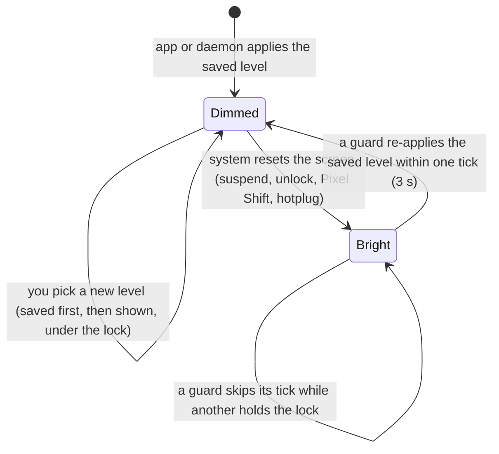

# Flicker-Free Dimming flow: statechart, invariants, proof

Reviewer aid for the dimming flow in `src/platform/display_sync.rs`. Four things take part, and
they interleave freely: the **app** and the **login daemon** (each runs a guard), **csd-color**
(Cinnamon resets the gamma ramp after every RandR change) and the **system** (suspend, unlock,
Pixel Shift, monitor hotplug).

## What the user sees



Review checklist: every bad state (`Bright`) is left by a guard on its own, with no user action;
nothing the app does makes the system reset the screen again; no state waits on a lock forever.

## Invariants

| # | Invariant | How it is checked |
| :-- | :-- | :-- |
| S1 | Once you have picked a new level, the screen never shows the old level again. | Exhaustive model: `scripts/model_dimming.py` |
| L | With no further system resets, the screen settles on the saved level and stays there. | Exhaustive model: `scripts/model_dimming.py` |
| I3 | Showing a level never makes the system reset the screen (no feedback loop). | Model variant; `tests/xrandr_uses_current.rs`; gamma is set with RandR `SetCrtcGamma` (`src/platform/x11_gamma.rs`) |
| I4 | A held lock never freezes the window: the UI waits at most 500 ms and then goes ahead, a guard just skips its tick. | Unit tests in `display_sync.rs` |
| I5 | The new level is saved before it is shown, in one step. | Unit test in `display_sync.rs` |

## Result

```
$ python3 scripts/model_dimming.py
bounds: 1 user change, up to 2 system resets, 2 guards

xrandr-apply (old)                    S1 VIOLATED  L VIOLATED   (as expected)
apply-then-save, no lock (old)        S1 VIOLATED  L holds      (as expected)
save-then-apply under lock (current)  S1 holds     L holds      (as expected)   0 deadlocks
status: pass
```

The two old variants are kept on purpose: the check must keep finding the bugs we fixed.

- **xrandr-apply (old)** is the screen that went bright again and again. Applying the level through
  `xrandr --brightness` re-sent the CRTC config, csd-color answered by resetting the ramp, a guard
  re-applied, and the loop never ended (`L` violated).
- **apply-then-save, no lock (old)** is the race this check found in the code that was installed:
  you pick a new level, a guard that had just loaded the old level puts it back, and it stays wrong
  until the next tick (`S1` violated). Trace: `ui` applies new, `guard` loads the old saved level,
  `ui` saves new, `guard` re-applies old.

The fix is the lock plus save-before-apply in `display_sync.rs`; the current variant holds both
properties.

## Bounds and assumptions (what this does not prove)

- Exhaustive only within the bounds: **one** user change, **at most two** system resets, two
  guards. It is a hand-written explicit-state search, not TLA+ or a proof for unbounded runs.
- It checks a model, not the Rust code. The model abstracts levels to `old` / `new` / `reset` and
  does not model time, so the 3 s guard interval is a measured value (about 1 s of bright screen in
  a forced reset on the target laptop), not a checked one.
- The lock covers `display_sync::save_then_apply` and the guards. The one-shot startup restore
  (`restore_saved_display_prefs`, `myasus-rs restore-display`) applies without it; it runs once at
  login and is not part of the interleavings above.
- X11 on AMDGPU + Cinnamon. Wayland and Windows are not covered.

Run it: `python3 scripts/model_dimming.py` (add `--json` for the full report with traces).
